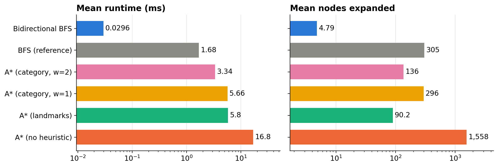
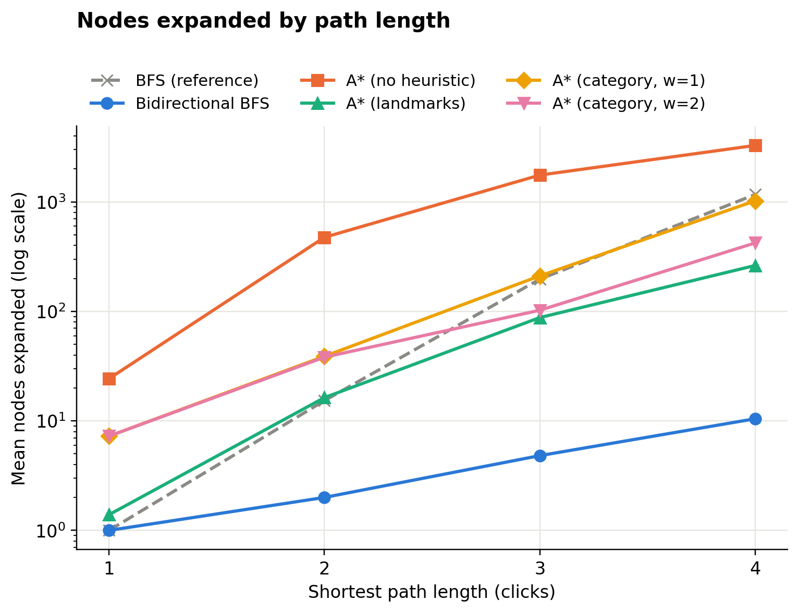

# Wikispeedia Pathfinding

This project finds the fewest clicks needed to go from one Wikipedia article to another, using only the links between them. Two search algorithms, **Bidirectional BFS** and **A\***, are implemented and compared on the Wikispeedia dataset.

## Dataset

The [Wikispeedia navigation paths](https://snap.stanford.edu/data/wikispeedia.html) dataset from SNAP, Stanford, is used. It comes from an online game where players try to reach a target article by clicking links.

- 4,604 articles
- 119,772 links, after removing 110 self-links
- 51,318 finished games played by people
- The true shortest distance between every pair of articles, used to check the results

The dataset files are not included in this repository. The notebook downloads them automatically when it runs. Manual download steps are given in [data/README.md](data/README.md).

## Problem Setup

Each article is treated as a node and each link as a directed edge. Every click has a cost of 1, so the best path is the one with the fewest clicks.

## Algorithms

- **BFS:** used as a reference, since it always finds the shortest path when every step has the same cost.
- **Bidirectional BFS:** one search runs forward from the start and another runs backward from the target, and the search stops when they meet. The backward search follows links in reverse, because links only go one way.
- **A\*:** the article with the lowest `f = g + h` is expanded first, where `g` is the number of clicks so far and `h` is an estimate of the clicks left.

Wikipedia articles have no coordinates, so three options for `h` were tested:

- **No heuristic (h = 0):** used as the baseline.
- **Landmark heuristic:** distances to and from 16 landmark articles are computed in advance, and the triangle inequality gives a lower bound on the distance left. It never overestimates, so A\* still finds the shortest path.
- **Category heuristic:** an estimate based on how close two articles are in Wikipedia's category tree, `h = w × (1 − similarity)`. With `w = 1` it never overestimates. With `w = 2` it searches less but can return longer paths.

The heuristic settings were chosen using 300 separate validation pairs. The final results are based on 1,000 test pairs taken from the human games.

## Results

The results below are from a run on Google Colab. Times will vary on other machines, but accuracy and node counts stay the same because the random seed is fixed.

| Algorithm | Accuracy | Nodes expanded | Peak memory | Mean time |
|---|---:|---:|---:|---:|
| Bidirectional BFS | 100% | 4.8 | 8 KiB | 0.030 ms |
| BFS (reference) | 100% | 305 | 96 KiB | 1.684 ms |
| A* (category, w=2) | 81.3% | 136 | 135 KiB | 3.340 ms |
| A* (category, w=1) | 100% | 296 | 201 KiB | 5.657 ms |
| A* (landmarks) | 100% | 90 | 97 KiB | 5.797 ms |
| A* (no heuristic) | 100% | 1,558 | 345 KiB | 16.795 ms |

Accuracy is the percentage of test pairs where a valid path of the true shortest length was found. The landmark heuristic also needs about 0.7 s of setup before searching. All algorithms correctly reported "no path" for 200 unreachable pairs.





## Findings

- Bidirectional BFS performed best. It was always correct, needed no setup, and expanded about 64 times fewer nodes than standard BFS.
- A\* with no heuristic did the most work, even more than BFS, because it only stops when the target is removed from the queue.
- The landmark heuristic reduced the nodes expanded by A\* by about 17 times and stayed 100% accurate. However, computing it for every node added time, so it was still slower than BFS.
- The category heuristic with `w = 2` searched fewer nodes, but found the shortest path in only 81.3% of cases.
- Human players took 5.32 clicks on average for the same pairs, while the shortest paths averaged 2.81 clicks.

## How to Run

The simplest option is to open `notebooks/AI_Project.ipynb` in Google Colab and select **Runtime → Run all**. A full run takes a few minutes.

To run it locally (Python 3.12 or newer):

```bash
git clone https://github.com/SSJemey/wikispeedia-pathfinding.git
cd wikispeedia-pathfinding
pip install -r requirements.txt jupyter
jupyter notebook notebooks/AI_Project.ipynb
```

The last cell of the notebook downloads the results as a zip file and only works in Colab. When running locally, it can be skipped, since the results are already saved in the `results` folder.

To run the tests after downloading the data:

```bash
python -m pytest
```

## Project Structure

```text
├── notebooks/AI_Project.ipynb   Main notebook with all code and outputs
├── src/                         The same code split into Python files
│   ├── data.py                  Data loading and cleaning
│   ├── search.py                BFS, Bidirectional BFS and A*
│   ├── heuristics.py            Landmark and category heuristics
│   └── evaluate.py              Accuracy, time and memory measurement
├── tests/test_search.py         Tests for the algorithms
├── results/                     Result tables (CSV) and charts
└── data/README.md               Dataset download steps
```

## References

1. R. West and J. Leskovec. Human Wayfinding in Information Networks. WWW, 2012.
2. R. West, J. Pineau and D. Precup. Wikispeedia: An Online Game for Inferring Semantic Distances between Concepts. IJCAI, 2009.
3. A. V. Goldberg and C. Harrelson. Computing the Shortest Path: A* Search Meets Graph Theory. SODA, 2005.

## License

The code is released under the [MIT License](LICENSE). The dataset belongs to its original authors and is not covered by this license.
